<!-- readme-standard: 2026-11-02 -->
<div align="center">



# Find Your Feathers 🪶

*Discover Your Wings. A sacred space for healing, transformation, and the journey home to yourself.*

[](LICENSE)
[](https://drasticstatic.github.io/findyourfeathers-public-preview/) [](https://github.com/open-condo-software/gitexporter) [](https://code.claude.com/docs/en/overview) [](https://github.com/drasticstatic/findyourfeathers)

 **You are here:** drasticstatic lab › source `findyourfeathers` (private) → twin `findyourfeathers-public-preview` (public) · `main` is the working branch

</div>

##  TL;DR

1.  **What this is.** A dev portal for findyourfeathers.org: an interactive FAQ and knowledge base in accordance with its healing and transformation services.
2.  **Who it is for.** People exploring those services, and whoever manages the Wix site, by hand or with an AI helper.
3.  **Do this first.** `npm install`, then `npm run dev`, or [visit the live site](https://www.findyourfeathers.org).

---

**🌐 [Explore the Public Preview →](https://drasticstatic.github.io/findyourfeathers-public-preview/)** · **🪶 [Visit the live site — findyourfeathers.org →](https://www.findyourfeathers.org)**

---

> 🔒 **Public mirror notice:** This repository is partially mirrored to a public preview via an automated GitHub Actions pipeline (GitExporter-inspired — GitExporter itself hit an unfixable native-dependency build issue, so this is a from-scratch, dependency-free replacement following the same denylist concept). The public version includes only sanitized source files. Private configuration, credentials, setup docs, and workflow files are excluded.

---

## 👋 About

**Find Your Feathers** 🪶 — a standalone personal healing & transformation site. Built as a luminous, contemplative space for self-discovery, with a focus on building an interactive FAQ interface and knowledge base in accordance with the services offered, enabling human and AI-assisted management of the Wix site.

This private repo is the build workspace. The public preview (`findyourfeathers-public-preview`) is the filtered output automatically synced on every push to `main`.

**Developer / builder:** Christopher Wilson (`drasticstatic`)
**AI agents:** Alfred (Claude Code CLI) — primary technical architect & builder

---

## 🎯 The Goal

Build a robust back-end context engine and interactive FAQ/knowledge-base interface in accordance with the healing and transformation services of findyourfeathers.org — a dev portal that collects data and presents content in an interactive Next.js static site. The FAQ database and Services pages serve as a workspace, enabling human and AI-assisted management of the Wix site. We aim to comply with GitHub Pages Terms of Service; as a solo developer learning to use code to help people, I may make mistakes along the way and welcome guidance.

---

## 🚀 Capabilities

### Core Features
- **Home** — Feather-branded landing page
- **Services** — Healing and transformation service listings
- **FAQ** — Comprehensive FAQ database (primary build focus)
- **Navbar** — Hamburger menu, "Explore" dropdown for FYF pages, GitHub link
- **Footer** — Discover Your Wings CTA, contact, GitHub source
- **Disclaimer Badge** — Persistent banner + concept-prototype disclosure modal
- **Custom 404** — Spiritual theme + site map

### Technical
- Next.js 16 (App Router) — Static Site Generation (`output: 'export'`)
- Tailwind CSS + Framer Motion — contemplative aesthetic, gentle animations
- TypeScript throughout — typed content data
- GitHub Pages deployment via public preview repo
- Private → public sync via GitHub Actions denylist pipeline (GitExporter-inspired)
- Dark-green + light-green mode toggle across all pages (localStorage-persisted, ThemeToggle in navbar)
- Emerald green theme system (distinct from gold-themed iamoneself)
- Emerald scroll progress bar, mobile hamburger menu

---

## 🗺️ Wix Site Map

The official Wix-hosted site at [findyourfeathers.org](https://www.findyourfeathers.org) includes:

| Page | URL |
|------|-----|
| Home | findyourfeathers.org |
| Services | findyourfeathers.org/services |
| FAQ | findyourfeathers.org/faq |
| Contact | findyourfeathers.org/contact |
| Who We Are | findyourfeathers.org/who-we-are |

> This dev portal serves as a workspace for building interactive FAQ interfaces and knowledge bases in accordance with the site's services, enabling human and AI-assisted management of the Wix site. It points to the official site for all services and contact.

---

## 🏗️ Architecture

```
Private Repo (source + secrets)              Public Repo (GitHub Pages host)
github.com/drasticstatic/findyourfeathers →→→ github.com/drasticstatic/findyourfeathers-public-preview
        │                                        │
        │  GitHub Actions (on push to main)      │
        │  filters denylist → pushes clean       │
        └──────────────────────────────────────► └── GitHub Pages live URL
```

```text
src/
├── app/
│   ├── page.tsx              → Home / Landing
│   ├── not-found.tsx         → Custom 404
│   ├── layout.tsx            → Root layout — Navbar, DisclaimerBadge, ScrollProgress, Footer
│   └── globals.css           → Tailwind imports and CSS variables
├── components/
│   ├── layout/               → Navbar (Feather icon, hamburger, Explore dropdown), Footer
│   ├── TeachingModal.tsx     → Teaching pill modal (scaffolded)
│   ├── DisclaimerBadge.tsx   → Persistent banner + disclosure modal
│   └── PageScrollProgress.tsx → Gold scroll progress bar
├── data/
│   └── faq.ts                → FAQ content data (scaffolded)
└── lib/
    └── utils.ts              → cn() and helpers
```

---

## 💻 Development

```bash
npm install
npm run dev
# Opens at http://localhost:3000
```

## 📦 Static Build

```bash
npm run build
# Produces static site in /out
```

---

## 🎨 Theme System (dark-green + light-green toggle)

FYF renders a true dark-green mode (default) and a soft light-green mode, both
affecting the *whole* site — body gradient, navbar, footer, hamburger, dropdown,
and disclaimer badge. The toggle is `ThemeToggle`-driven (`.dark` class on
`<html>`, persisted in `localStorage`) in the navbar.

- **Body** — fixed mint gradient (`html.dark` deep-green / `html:not(.dark)`
  light mint), not a flat fill, so the whole page reads as green in both modes.
- **Chrome** — solid `bg-emerald-200` (light) / `bg-neutral-950` (dark) on navbar,
  footer, and hamburger. No translucency or blur on persistent chrome so nothing
  desaturates on scroll; the frost (`backdrop-blur`) lives on the dropdown + modal
  where it overlays a darkened backdrop.
- **Disclaimer badge** — light `bg-emerald-300` (one step deeper than the navbar's
  `emerald-200`) so it stays visibly distinct from the navbar; dark `bg-emerald-950/80`.
- **Tailwind v4 + class-toggle** — Tailwind v4's `dark:` variant defaults to
  `@media (prefers-color-scheme: dark)` (the OS), *not* the `.dark` class the
  toggle sets. Without the override the body obeys the toggle but every `dark:*`
  chrome utility follows the OS. `globals.css` repoints it:
  `@custom-variant dark (&:where(.dark, .dark *));`

---

## 📜 License

This repository is the private development source — not licensed for
reuse. Its [public preview](https://github.com/drasticstatic/findyourfeathers-public-preview)
is available under the [MIT License](https://github.com/drasticstatic/findyourfeathers-public-preview/blob/main/LICENSE).

##  Suggest a change

Noticed something? Open an [issue](../../issues) or a pull request against `main`; Christopher reads them and a person with the role merges. Not on GitHub? Reach him through any channel on [his profile](https://github.com/drasticstatic). On the public preview, please open an issue rather than a pull request: its files are synced from the private source, so a change made only there would be overwritten.

<sub>The front door follows the living [README standard](https://github.com/drasticstatic/my-template/blob/main/README-STANDARD.md). Copy it, improve it.</sub>
